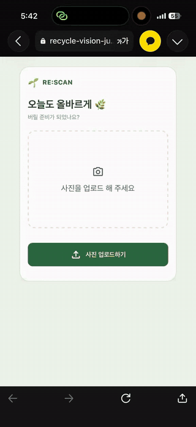
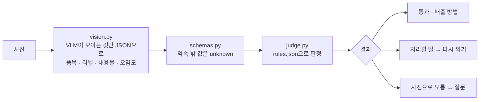
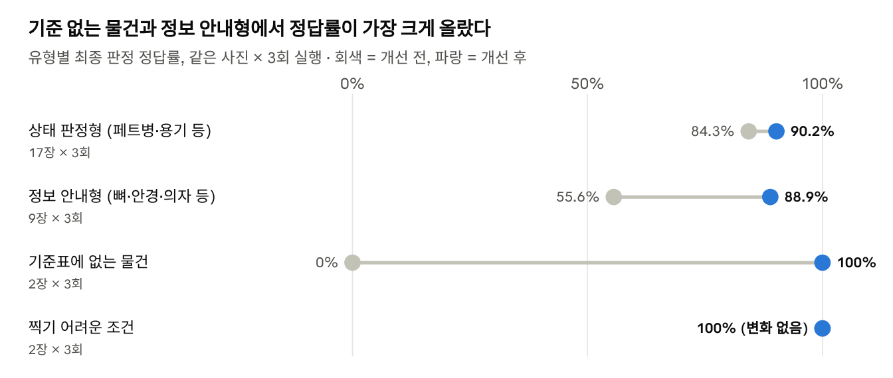

# RE:SCAN · AI 분리배출 판정 도우미

> 사진 한 장으로 **지금 버려도 되는지**, 아니면 라벨 제거·헹굼처럼 **버리기 전에 무엇을 해야 하는지** 알려 주는 웹 서비스

**[서비스 바로 써 보기](https://recycle-vision-judge.vercel.app)** · 2026 인공지능학과 대학 연합 해커톤 23팀 

<p align="center"><br><sub>유리컵을 찍으면 "유리병류가 아니에요"와 버리는 곳·방법을 안내합니다 · <a href="docs/RE-SCAN_demo.mp4">전체 시연 영상</a></sub></p>

| | |
| --- | --- |
| **최종 판정 정답률** | 71.1% → **91.1%** (실제 사진 30장 × 3회) |
| **품목 정확도** | 81.1% → **94.4%** |
| **평균 응답 시간** | 4.8초 → **3.3초** |
| **지원 품목** | 55개 (상태 판정형 14 · 정보 안내형 41) + 기준이 없는 물건은 일반 원칙으로 안내 |
| **자동 테스트** | AI 없이 도는 판정 63 · API 15 · 예외 상황 64건, push마다 GitHub Actions 실행 |

---

## 개요

분리배출 기준은 품목마다, 같은 품목이라도 **상태마다** 다릅니다. 투명 페트병은 라벨을 떼고 비워야 전용 수거함에 넣을 수 있고, 컵라면 용기는 빨간 기름 자국이 남아 있으면 재활용되지 않습니다. 치킨 뼈, 알약 포장재, 안경처럼 애매한 물건은 매번 검색해야 합니다.

## 주요 기능

| 기능 | 설명 |
| --- | --- |
| 상태 판정 | 라벨 · 내용물 · 오염도(1~5단계) · 뚜껑 등을 보고 "통과" 또는 "처리할 일" 체크리스트 |
| 처리 후 다시 찍기 | 같은 물건인지 확인한 뒤 다시 판정. 3번 안에 해결되지 않으면 대체 배출 방법 안내 |
| 사진으로 모르는 것은 질문 | "헹궜어요?", "아이스팩 내용물이 물인가요, 젤인가요?", "안경테 재질은?" |
| 버리는 방법과 장소 | 단계별 방법, 아파트 · 단독주택별 배출 장소, 주의사항, 출처 |
| 기준이 없는 물건 | "지원 안 함"으로 끝내지 않고 일반쓰레기 · 불연성 · 대형폐기물 · 전자제품 원칙으로 안내 |
| 품목이 달라요 | AI가 틀려도 검색해서 고르면 그 품목 기준으로 지금 사진을 다시 판정 |

## 핵심 설계: AI는 관찰, 판정은 규칙표



| 결정 | 이유 |
| --- | --- |
| AI는 관찰만, 판정은 규칙표 | AI가 배출 기준을 지어내지 못하게. 기준이 바뀌면 코드가 아니라 `rules.json`만 수정 |
| 모르면 단정하지 않음 | 안 보이면 `unknown` → 다시 찍기나 질문. "처리가 필요한데 통과"를 가장 나쁜 오류로 봄 |
| 질문에 답할 때 AI 재호출 0회 | 같은 사진의 관찰 결과를 재사용해 빠르고 답이 흔들리지 않음 |
| 다시 찍을 때 관찰과 비교를 분리 | 두 사진을 한 번에 주면 처음 사진의 라벨을 지금 사진에 옮겨 적는 문제가 있어, 별도 호출로 동시에 실행 |
| 규칙표를 서버 시작 시 검사 | 키 오타, 없는 품목으로 분기, 빠진 문구가 있으면 서버가 켜지지 않음 |

## 검증: 실제 사진 평가

팀원이 수집한 사진 30장(정상 상황과 놓치기 쉬운 상황, 상태 판정형 17 · 헷갈리는 물건 9 · 기준 없는 물건 2 · 찍기 어려운 조건 2)을 사진마다 3번씩 돌려 개선 전후를 비교했습니다. 모델(gpt-4o-mini), 사진, 정답은 같고 프롬프트와 규칙표만 바꿨습니다.

<p align="center"></p>

| 지표 | 개선 전 | 개선 후 |
| --- | --- | --- |
| 최종 판정 정답 | 64/90 (71.1%) | 82/90 (91.1%) |
| 품목 정확도 | 73/90 (81.1%) | 85/90 (94.4%) |
| 잘못된 통과 (0이어야 함) | 3 | 2 |
| 3번 돌렸을 때 답이 흔들린 사진 | 9/30 | 6/30 |
| 평균 / 최대 응답 시간 | 4.8초 / 15.4초 | 3.3초 / 8.3초 |

재현: `python tests/run_tests.py --repeat 3` · 결과 [`tests/results/`](tests/results/) · 케이스와 정답 [`tests/cases.json`](tests/cases.json)

## 문제 해결 기록

**1. 라벨을 떼고 다시 찍어도 "라벨을 떼 주세요"**
- 원인: 처음 사진과 지금 사진을 한 번에 보내 "같은 물건인지 비교 + 지금 사진 관찰"을 함께 시켰더니, AI가 처음 사진의 라벨을 지금 사진에도 있다고 답함
- 해결: 지금 사진 관찰과 같은 물건 비교를 **별도 호출로 분리해 동시에 실행**. 프롬프트로 막는 대신 구조로 막음

**2. 유리컵 → 종이컵, 케첩통 → 투명 페트병**
- 원인: 모양만 보고 품목을 고르고, 재질은 판단하지 않음
- 해결: 프롬프트에 "재질을 먼저 판단" 단계(유리 · 플라스틱 · 종이 · 스티로폼의 시각적 단서)를 넣고, 품목 설명에 헷갈리는 짝을 명시. 같은 사진에 같은 답이 나오게 temperature 0

**3. 안경 · 의자 · 머리끈이 "지원하지 않는 품목"으로 끝남**
- 원인: 기준표에 없으면 판정을 포기
- 해결: 근거가 확인된 품목은 추가하고, 그래도 없는 물건은 AI가 큰 분류만 보고 **규칙표가 일반 원칙으로 안내**. 화면에는 "일반 원칙에 따른 안내"라고 분명히 표시
- 결과: 기준 없는 물건 0/6 → 6/6, 헷갈리는 물건 15/27 → 24/27

## 한계와 다음 단계

- 화면 끝에 잘린 부품(소주병 뚜껑)을 "없음"으로 보는 경우가 남아 있음 → 잘린 부분은 `unknown`으로 답하게 개선 예정
- 평가 사진 30장은 작은 표본이라 숫자는 개선 방향을 보여 주는 정도
- 관찰 부분만 경량 이미지 모델(CNN)로 바꿔 같은 평가 세트로 정확도와 속도 비교 (판정 · 규칙 · 화면은 그대로)

## 팀 구성과 내 역할

2026 인공지능학과 대학 연합 해커톤 23팀 (4인)

| 이름 | 역할 |
| --- | --- |
| 홍승범 | 백엔드 · AI: 판정 구조 설계와 구현, 프롬프트, 자동 테스트 · CI, 실제 사진 평가 설계와 개선, 배포 |
| 유지수 | 세부 기획, 품목 · 배출 기준 자료 조사, 테스트용 사진 수집 |
| 이아영 · 안지혜 | 프론트엔드 디자인(RE:SCAN)과 구현 |

**My Role**

- "AI는 관찰만, 판정은 규칙표"로 나누는 판정 구조 설계와 구현 (FastAPI, OpenAI Vision API)
- 팀이 조사한 공공기관 분리배출 기준을 규칙표(`rules.json`)로 옮기고, 서버 시작 시 규칙표 오류를 막는 스키마 작성
- 평가 세트(30장 · 정답 · 측정 지표)를 설계하고, 실행 · 채점 결과로 오류 패턴을 찾아 프롬프트와 규칙 개선
- AI 없이 도는 자동 테스트 142건과 GitHub Actions CI, Render(백엔드) · Vercel(프론트) 배포, 요청 수 제한 등 배포 보호
- 프론트와의 API 약속(`API.md`)을 정하고, 품목 검색 선택 · "품목이 달라요" 같은 판정 흐름 기능을 화면에 연결

## 폴더 구조

```
├── backend/
│   ├── app.py            # FastAPI 서버 (/judge, /items, /health), 오류 형식 통일, 요청 수 제한, 요청 로그
│   ├── vision.py         # 사진 전처리 + AI 관찰, 재촬영 시 같은 물건 비교 (프롬프트는 rules.json에서 생성)
│   ├── judge.py          # 규칙표 기반 판정
│   ├── schemas.py        # Pydantic 스키마 (규칙표 · AI 관찰 · 응답)
│   ├── rules.json        # 판정기준표: 품목 55개, 조건, 오염도 5단계, 배출 장소, 일반 원칙, 화면 문구
│   ├── config.py         # 설정값 (.env로 변경)
│   └── API.md            # 프론트 ↔ 백엔드 약속
├── frontend/src/
│   ├── App.jsx           # 촬영 → 판정 → 질문 · 재촬영 흐름
│   ├── components/       # JudgeResult (결과 화면), ItemPicker (품목 검색 선택)
│   └── services/         # judgeApi (서버 호출 · 사진 축소), responses.json (Mock)
├── tests/
│   ├── test_judge.py · test_api.py · test_edge_cases.py   # AI 없이 도는 자동 테스트
│   ├── run_tests.py · cases.json                         # 실제 사진 평가
│   └── results/                                          # 평가 결과 (개선 전 · 후)
└── .github/workflows/ci.yml
```

## 기술 스택

FastAPI · Pydantic v2 · OpenAI Vision API (gpt-4o-mini) · React (Vite) · GitHub Actions · Render · Vercel

## 실행

```bash
# 백엔드
python3 -m venv venv && source venv/bin/activate
pip install -r backend/requirements.txt
echo "OPENAI_API_KEY=sk-..." > .env
cd backend && python app.py                 # http://127.0.0.1:5001/docs

# 프론트엔드 (다른 터미널)
cd frontend && npm install && npm run dev   # http://localhost:5173

# 테스트 (AI 호출 없음)
python tests/test_judge.py && python tests/test_api.py && python tests/test_edge_cases.py
```
