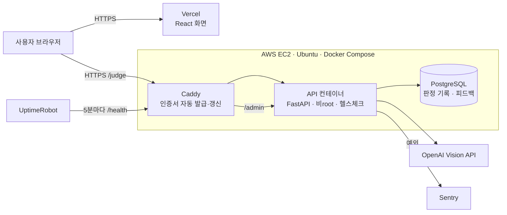

# 운영 구조

해커톤 이후 백엔드를 Render에서 AWS EC2로 옮기고, 장애를 사용자보다 먼저 알 수 있게 감시와 에러 추적을 붙였습니다.



## 구성

| 영역 | 무엇을 | 왜 |
|---|---|---|
| 서버 | AWS EC2 (Ubuntu), Docker Compose | 로컬 · CI · 서버가 같은 이미지로 실행. 서버를 옮겨도 같은 명령으로 재배포 |
| HTTPS | Caddy 리버스 프록시, Let's Encrypt 자동 인증서 | HTTPS 화면(Vercel)은 HTTP API를 부를 수 없음 |
| 노출 범위 | 외부에는 80 · 443만, API 포트는 비공개. SSH는 내 IP만 | 공격 면 줄이기 |
| 비밀값 | API 키는 서버 `.env`에만. 이미지 · 저장소 · Vercel에는 없음 | 키 유출 경로 차단 |
| 헬스체크 | 컨테이너 `HEALTHCHECK` + `restart: unless-stopped` | 프로세스가 멈추면 unhealthy 표시 후 재시작 |
| 외부 감시 | UptimeRobot이 5분마다 `/health` 확인, 실패 시 메일 | 서버 전체가 죽어도 사용자보다 먼저 알기 |
| 에러 추적 | Sentry (`SENTRY_DSN`이 있을 때만) | AI 호출 실패 · 처리 못 한 예외를 원인과 함께 모으기. 사진 · 요청 본문 · IP는 보내지 않음 |
| 요청 로그 | 판정마다 상태 · 품목 · 확신도 · 처리 시간(ms)을 JSON 한 줄로 | 응답 시간과 실패 유형을 숫자로 보기 |
| 비용 보호 | IP당 분당 20회, 사진 15MB 제한 | 주소가 공개돼도 AI 비용 폭주 방지 |
| 판정 기록 | PostgreSQL 컨테이너 (포트 비공개, 볼륨 보관), 매일 백업 7일치 | 실제 사용에서 정확도를 보고 오답을 평가 세트로 되돌리기 |
| 관리자 | `/admin` (토큰 보호, 없으면 404), 관리자 API에도 요청 수 제한 | 서버에 들어가지 않고 판정 수 · 정답률 · 틀린 사례 확인 |

## 자주 쓰는 명령 (서버)

```bash
cd ~/recycle-vision-judge/deploy      # DOMAIN, POSTGRES_PASSWORD는 deploy/.env에서 읽는다

docker compose ps                         # 상태 (api가 healthy인지)
docker compose logs --tail=50 api         # 최근 로그
docker compose logs api | grep '"ms"'     # 판정 처리 시간만

# 새 코드 배포
cd .. && git pull && cd deploy && docker compose up -d --build

# .env만 바꿨을 때
docker compose up -d --force-recreate api

# 판정 기록 직접 보기
docker compose exec db psql -U rescan -d rescan -c "select status, count(*) from judgments group by status;"
```

## 운영 데이터: 판정 기록과 피드백

```
판정마다 기록 (사진 · IP 없음) → 사용자 "맞았어요 / 틀렸어요" → /admin 에서 오답 확인
  → tests/export_feedback.py 로 평가 세트 후보 목록 → 같은 상황 사진을 찍어 cases.json에 추가
  → run_tests.py --save → compare_runs.py 이전.json 새.json --strict  (나빠졌으면 배포하지 않음)
```

| 저장하는 것 | 저장하지 않는 것 |
|---|---|
| 품목, 판정 결과, AI가 본 값, 확신도, 처리 시간, 사용자가 답한 질문, 피드백과 의견 | 사진, IP, 기기 정보 |

설계 원칙: **DB가 죽어도 판정은 계속된다.** 저장에 실패하면 로그와 Sentry에만 남기고, 판정 응답은 `judgment_id` 없이 그대로 나간다. 화면은 `judgment_id`가 없으면 피드백 버튼만 숨긴다.

### 처음 켤 때 (서버, 한 번만)

```bash
cd ~/recycle-vision-judge
# 1) DB 비밀번호와 도메인 (deploy/.env, 저장소에 올리지 않음)
printf "DOMAIN=<IP를-대시로>.sslip.io\nPOSTGRES_PASSWORD=%s\n" "$(openssl rand -hex 24)" > deploy/.env
# 2) 관리자 토큰 (.env에 추가). 출력된 값은 비밀번호 관리자에 보관
echo "ADMIN_TOKEN=$(openssl rand -hex 24)" >> .env && grep ADMIN_TOKEN .env
# 3) 배포
cd deploy && docker compose up -d --build && docker compose ps
# 4) 매일 새벽 4시 10분 백업 (7일치 보관)
(crontab -l 2>/dev/null; echo "10 4 * * * $HOME/recycle-vision-judge/deploy/backup.sh >> $HOME/backup.log 2>&1") | crontab -
```

## 장애가 나면

1. UptimeRobot 메일 또는 사용자 제보 → `docker compose ps`로 컨테이너 상태 확인
2. `docker compose logs api`와 Sentry에서 마지막 오류 확인
3. 코드 문제면 직전 커밋으로 되돌려 재배포 (`git checkout <커밋> && docker compose up -d --build`), 원인은 그다음에 분석
4. 원인 · 조치 · 재발 방지를 이 문서 아래 기록에 남김

## 운영 기록

### 2026-11-23 · Render → AWS EC2 이전

- 문제: 플랫폼 런타임에 맞춰 배포하다 보니 로컬과 서버 환경이 어긋날 수 있었고, 서버 상태를 직접 확인하거나 설정할 수 없었음
- 판단: Docker 이미지로 환경을 고정하고, Linux VM에서 직접 운영. Vercel 화면이 HTTPS라 API도 HTTPS가 필요해 Caddy로 인증서 자동화
- 해결: EC2(Ubuntu)에 Docker Compose로 API + Caddy 배포, API 포트 비공개, SSH 접근 IP 제한, 비밀값은 서버 `.env`에만
- 결과: HTTPS `/health` 정상, 프론트 → AWS 판정 요청 확인(처리 3.5초). 이전 후 CI의 docker 작업이 같은 이미지를 push마다 빌드 · 실행 검사

### 2026-11-23 · 가동 감시가 정상 서버를 Down으로 판정

- 문제: UptimeRobot을 붙이자마자 서버가 정상인데도 Down 알림
- 판단: 로그에서 감시 요청만 `HEAD /health` → 405로 실패한 것을 확인. 감시 도구는 기본으로 HEAD를 보내는데 `/health`는 GET만 받고 있었음
- 해결: `/health`가 GET과 HEAD를 모두 받도록 수정하고, CI의 docker 작업에 HEAD 요청 검사를 추가
- 결과: 감시 Up 전환. 감시 도구를 바꿔도 같은 문제가 다시 생기지 않게 CI가 막음

### 2026-11-24 · 재배포 뒤 API가 켜지지 않음 (약 1시간)

- **증상**: 2단계(판정 기록 DB) 배포 뒤 서비스 화면에 "서버에 연결할 수 없어요". `/health`가 빈 응답(502)
- **확인**: `docker compose ps`에서 api만 `Restarting`, db · caddy는 정상. 로그에 `TypeError: Unknown option 'send_default_pii'`
- **원인**: `requirements.txt`가 `sentry-sdk>=2.0`으로 상한이 없어, 이미지를 다시 빌드할 때 새 메이저 버전이 설치됨. 그 버전에서 쓰던 옵션이 없어져 앱이 시작되지 않음. CI에는 Sentry 주소(DSN)가 없어서 초기화 코드가 실행되지 않아 잡지 못함
- **조치**: `sentry-sdk[fastapi]>=2.0,<3`으로 고정하고 api만 다시 빌드
- **재발 방지**: CI에 가짜 DSN을 넣어 운영과 같은 설정으로 컨테이너가 켜지는지 검사 추가. 외부 라이브러리는 메이저 버전 상한을 둠
- **배운 점**: 테스트가 운영과 다른 설정으로만 돌면 운영에서만 나는 오류는 못 잡는다. 재빌드는 의존성까지 바뀌는 배포라는 점도 확인

