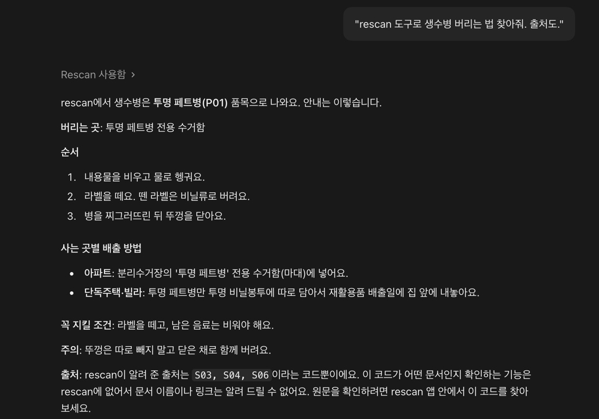

# RE:SCAN MCP 서버

분리배출 판정과 배출 기준 조회를 **MCP(Model Context Protocol) 도구**로 엽니다.
Claude Desktop 같은 AI 에이전트가 "이 사진 버려도 돼?"라는 질문에 RE:SCAN 판정 결과를 근거로 답할 수 있습니다.

| 도구 | 하는 일 | AI 호출 |
|---|---|---|
| `search_items` | 이름·별칭으로 품목 검색 (예: "생수병" → P01) | 없음 (규칙표만 읽음) |
| `get_disposal_rule` | 품목ID로 버리는 곳, 순서, 필수 조건, 주의, 출처 조회 | 없음 |
| `judge_photo` | 사진 파일을 운영 중인 RE:SCAN API로 보내 판정. 질문이 오면 `answers`로 다시 호출 | 있음 (서버에서) |

## 왜 이렇게 만들었나

| 결정 | 이유 |
|---|---|
| 배출 기준은 규칙표 결과만 돌려줌 | 서비스와 같은 원칙. 에이전트(LLM)가 기준을 지어내지 않고 도구 결과를 전달만 하도록 instructions에도 명시 |
| 판정은 배포된 API에 맡김 | OpenAI 키를 사용자 컴퓨터에 둘 필요가 없고, 서버의 요청 제한·로그·에러 추적을 그대로 씀 |
| 조회 도구는 로컬 규칙표만 읽음 | 네트워크·비용 없이 빠르게 답함 |
| 보내기 전에 파일 확인 | 없는 파일, 사진이 아닌 파일, 15MB 초과는 서버에 보내기 전에 거름 |
| 오류는 원인 + 다음 행동 한 문장 | 에이전트가 사용자에게 그대로 전달하거나 다음 도구를 고를 수 있게 (예: "search_items로 품목ID를 먼저 찾아 주세요") |

## 설치와 연결 (Claude Desktop)

Python 3.10 이상이 필요합니다. macOS 기본 Python(3.9)이면 3.12를 따로 설치하고 가상환경을 만듭니다.

```bash
brew install python@3.12
python3.12 -m venv mcp_server/.venv
mcp_server/.venv/bin/pip install -r mcp_server/requirements.txt
```

Claude Desktop 설정 파일(`~/Library/Application Support/Claude/claude_desktop_config.json`)의 최상위에 추가합니다. 기존 항목은 그대로 둡니다.

```json
{
  "mcpServers": {
    "rescan": {
      "command": "/절대/경로/recycle-vision-judge/mcp_server/.venv/bin/python",
      "args": ["/절대/경로/recycle-vision-judge/mcp_server/server.py"]
    }
  }
}
```

Claude Desktop을 다시 열고 이렇게 물어보면 됩니다.

- "생수병은 어떻게 버려? 기준 출처도 알려 줘" → `search_items` → `get_disposal_rule`
- "~/Downloads/bottle.jpg 이거 지금 버려도 돼?" → `judge_photo`
- 판정이 질문을 돌려주면("헹궜나요?") 답한 내용이 `answers`로 다시 전달됩니다.

다른 판정 서버를 쓰려면 환경 변수 `RESCAN_API_URL`을 지정합니다 (기본값: 운영 서버).

## 실제 연결 확인 (2026-11-24)

Claude Desktop(macOS)에 연결해 운영 서버까지 호출했습니다.



| 확인 | 결과 |
|---|---|
| "생수병" 조회 | `search_items` → P01 투명 페트병, `get_disposal_rule` → 버리는 곳·순서·필수 조건·출처(S03, S04, S06) |
| 과자 봉지 사진 판정 | `judge_photo` → AWS 운영 API → P10 비닐류, 아파트/주택별 배출 장소 |

연결하면서 찾은 것:

- **웹 검색이 켜져 있으면 에이전트가 도구 대신 검색을 고를 수 있다.** 첫 질문에서는 도구를 쓰지 않고 웹 문서로 답했다. 도구 이름을 질문에 넣거나 검색을 끄면 도구를 썼다. 도구 설명(description)을 "분리배출 질문이면 먼저 이 도구"처럼 더 분명히 쓰는 것이 다음 개선점이다.
- **출처가 코드로만 나간다.** 에이전트가 S03이 어떤 문서인지 사용자에게 알려 주지 못했다. 출처 목록은 판정기준표의 출처 탭에만 있어서, rules.json에 출처 이름과 링크를 함께 넣어야 한다.
- **비닐류 기준에 고체 내용물 조건이 없다.** 과자가 남은 봉지를 "비우세요" 없이 통과시켰고, 없는 플라스틱 부품을 있다고 본 체크리스트도 붙었다. 평가 사진에 추가해 기준을 고칠 항목이다.

## 테스트

```bash
python tests/test_mcp.py      # AI·네트워크 없이. judge_photo는 실제 백엔드 앱에 연결해 검사
```

CI(GitHub Actions)의 `mcp` 작업이 push마다 실행합니다.
